# data_preprocess 模块结构图

> 数据预处理模块（`data_load.py`）：把企业多格式文件（.txt / .json / .jsonl / .md / .markdown）统一加载为 LangChain `Document` 列表并完成清洗，是后续向量化的唯一数据入口。

```mermaid
flowchart TD
    subgraph M1["模块一 · data_preprocess（data_load.py）—— 文档加载与清洗预处理"]
        direction TB

        INPUT["输入：单个文件 file_path / 目录 directory<br/>支持 .txt .json .jsonl .md .markdown"]

        subgraph L["DataLoaderModule · 多格式加载器（统一入口）"]
            LOAD["load(file_path)<br/>① 校验扩展名<br/>② 按格式分发到对应 Loader<br/>③ 补充元数据<br/>④ 执行清洗管道"]
            BATCH["load_batch(directory, recursive)<br/>批量加载目录（可递归扫描）<br/>单文件失败仅记日志，不中断整体"]
        end

        subgraph F["三种底层 Loader（格式分发）"]
            TXT["_load_txt()<br/>TextLoader<br/>按 encoding 读取纯文本"]
            JSON["_load_json()<br/>JSONLoader<br/>jq_schema 定位结构<br/>content_key 取正文字段<br/>支持 .jsonl"]
            MD["_load_markdown()<br/>UnstructuredMarkdownLoader<br/>single：整篇一块<br/>elements：按标题/段落拆块"]
        end

        META["_enrich_metadata()<br/>为每个 Document 追加元数据：<br/>source 绝对路径 · filename · file_type<br/>供下游溯源与引用展示"]

        subgraph C["CleanPipeline · 可组合清洗管道（与格式解耦，可自定义 steps）"]
            S1["① remove_control_chars()<br/>剔除不可打印控制字符<br/>（保留换行、制表符）"]
            S2["② normalize_whitespace()<br/>合并连续空格/制表符<br/>压缩 3+ 连续空行"]
            S3["③ remove_boilerplate()<br/>正则移除版权声明、<br/>页码、Confidential 等噪音行"]
            S4["④ filter_empty_docs(min_length=10)<br/>过滤清洗后过短的无效块"]
        end

        OUTPUT["输出：List&#91;langchain Document&#93;<br/>下游：embedding_storage.FAISSManager.build_index()"]
    end

    INPUT --> LOAD
    INPUT --> BATCH
    BATCH -->|"逐文件调用"| LOAD
    LOAD --> TXT
    LOAD --> JSON
    LOAD --> MD
    TXT --> META
    JSON --> META
    MD --> META
    META --> S1 --> S2 --> S3 --> S4 --> OUTPUT

    classDef inout fill:#e8f5e9,stroke:#2e7d32,color:#1b5e20;
    classDef loader fill:#e3f2fd,stroke:#1565c0,color:#0d47a1;
    classDef clean fill:#fff3e0,stroke:#ef6c00,color:#bf360c;
    class INPUT,OUTPUT inout;
    class LOAD,BATCH,TXT,JSON,MD,META loader;
    class S1,S2,S3,S4 clean;
```

## 结构与功能解读

- **两大组成**：`CleanPipeline`（4 个清洗函数可自由组合）与 `DataLoaderModule`（统一入口 `load()` / 批量 `load_batch()` + 3 个格式专用 Loader + 元数据增强）。
- **处理流水线**：文件 → 按扩展名分发 → 追加 source/filename/file_type 元数据 → 三步清洗 → 过滤过短块 → `List[Document]`。

## 备注

- `chunk_size` / `chunk_overlap` / `glob_pattern` 参数已声明但未参与处理逻辑；当前流程没有文本切片步骤（分块实际依赖 markdown 的 elements 模式）。
