# embedding_storage 模块结构图

> 向量化与存储模块（`embedding_model.py` + `faiss_manager.py`）：负责文本向量化与 FAISS 向量库的全生命周期管理（建索引、持久化、加载、增删、相似检索、转 Retriever）。

```mermaid
flowchart TD
    subgraph M2["模块二 · embedding_storage（embedding_model.py + faiss_manager.py）—— 向量化与 FAISS 存储"]
        direction TB

        DOCS["上游：List&#91;Document&#93;<br/>（data_preprocess 产出）"]

        subgraph E["① Embedding 模型层（embedding_model.py）"]
            HF["EmbeddingModelManagerWithHuggingFace<br/>本地模型 BAAI/bge-small-zh-v1.5<br/>device=cpu · batch_size=32<br/>normalize_embeddings=True（归一化，利于相似度计算）"]
            DASH["EmbeddingModelManagerWithDashScope<br/>云端 text-embedding-v4（需 DASHSCOPE_API_KEY）<br/>仅初始化 embeddings，未提供包装方法"]
            ED["embed_documents(texts)<br/>批量文档 → 二维向量列表"]
            EQ["embed_query(text)<br/>单条查询 → 一维向量"]
            EG["get_embeddings()<br/>返回底层 Embeddings 实例"]
        end

        subgraph F["② FAISSManager · 向量库管理器（faiss_manager.py）"]
            INIT["__init__()<br/>注入 Embedding 管理器 + index_path<br/>（默认 vector_db/faiss_index）<br/>vector_store 初始为 None"]
            BUILD["build_index(documents, ids)<br/>校验文档非空 → uuid4 生成唯一 ID →<br/>校验 ID 数量与唯一性 →<br/>FAISS.from_documents 建索引"]
            PERSIST["save_index() / load_index()<br/>save_local 持久化 / load_local 加载<br/>（目录不存在时自动创建）"]
            MUTATE["add_documents() / delete_documents()<br/>增量入库新文档 / 按 ID 删除向量"]
            SEARCH["similarity_search(query, k=4, filter)<br/>similarity_search_with_score()<br/>返回最相似 k 个文档（可带距离分数做阈值过滤）"]
            RETRIEVE["as_retriever()<br/>包装为 LangChain VectorStoreRetriever<br/>（默认 k=4）→ 供 task_chain 使用"]
        end

        VSTORE[["self.vector_store : FAISS<br/>真正的索引对象<br/>所有增删检索前都要求已 build/load"]]
        DISK[("本地磁盘索引<br/>index.faiss + index.pkl")]
    end

    HF --> ED
    HF --> EQ
    HF -->|"注入 Embedding 管理器"| INIT
    DASH -.->|"预留云端实现（当前未接入）"| INIT
    DOCS --> BUILD
    INIT --> BUILD --> VSTORE
    VSTORE -->|"save_local 持久化"| DISK
    DISK -->|"load_local 恢复"| VSTORE
    MUTATE --> VSTORE
    SEARCH --> VSTORE
    EQ -.->|"检索时查询向量化"| SEARCH
    VSTORE --> RETRIEVE
    RETRIEVE --> NEXT["下游：task_chain 子任务二 · 知识库检索"]

    classDef emb fill:#e8eaf6,stroke:#3949ab,color:#1a237e;
    classDef mgr fill:#fce4ec,stroke:#c2185b,color:#880e4f;
    classDef store fill:#fffde7,stroke:#f9a825,color:#f57f17;
    class HF,DASH,ED,EQ,EG emb;
    class INIT,BUILD,PERSIST,MUTATE,SEARCH,RETRIEVE mgr;
    class VSTORE,DISK store;
```

## 结构与功能解读

- **两层结构**：Embedding 模型层（本地 HF 版可用，DashScope 云端版预留）+ `FAISSManager` 管理器（8 组方法）。
- **核心状态机**：`vector_store` 初始为 `None`，必须先 `build_index()` 或 `load_index()` 才能做增删检索；`as_retriever()` 是对外提供给任务链的标准检索接口。

## 备注

- `EmbeddingModelManagerWithDashScope` 未提供 `embed_documents / embed_query / get_embeddings` 包装方法，而 `FAISSManager` 依赖 `get_embeddings()`，因此当前只能搭配 HuggingFace 管理器使用。
