# prompt_engineering 模块结构图

> 提示词工程模块（5 个文件协作）：完成"提示词设计 → 结构化输出 → 解析 → 引用真实性校验"的闭环，回答必须来自检索资料且引用可溯源。

```mermaid
flowchart TD
    subgraph M3["模块三 · prompt_engineering（5 个文件协作）—— 提示词设计 + 输出解析 + 引用校验"]
        direction TB

        subgraph P1["① qa_prompt.py · 四段式提示词文本（纯常量，内容层）"]
            ROLE["ROLE_PROMPT · 角色定义<br/>专业的企业智能问答助手<br/>只依据企业知识库作答"]
            TASK["QA_TASK_PROMPT · 任务说明<br/>理解问题 → 提取信息 →<br/>归纳整理 → 组织中文答案"]
            CONS["QA_CONSTRAINT_PROMPT · 五类约束<br/>知识来源 / 信息不足 / 来源引用<br/>内容安全（防提示注入）/ 表达风格"]
            FORMAT["QA_OUTPUT_PROMPT · 输出格式<br/>指定 JSON 结构；status 三态：<br/>answered / insufficient_information / conflict"]
        end

        subgraph P2["② qa_template.py · EnterpriseQAPrompt 模板装配"]
            TPL["ChatPromptTemplate.from_messages<br/>system：{role} + {task} + {constraints} + {output_format}<br/>human：参考资料 {context} + 用户问题 {question}"]
            PARTIAL["partial() 固化四段提示词<br/>运行时只需注入 context / question"]
        end

        subgraph P3["③ answer_schema.py · Pydantic 标准输出结构"]
            CIT["Citation<br/>source_id 资料编号 · quote 原文片段<br/>extra=forbid 拒绝多余字段"]
            EA["EnterpriseAnswer · 最终答案对象<br/>status 三态 · answer 非空<br/>citations · confidence(0~1 自评)<br/>follow_up_questions<br/>Pydantic 自动校验类型与取值"]
        end

        subgraph P4["④ enterprise_parser.py · EnterpriseAnswerParser 输出解析"]
            PARSE["parse(text) 六步解析<br/>空检查 → 剥离 ```json 代码块 →<br/>截取首尾 { } → json.loads →<br/>根节点必须是对象 → Pydantic 校验<br/>任一步失败抛 OutputParserException"]
            FMT["get_format_instructions()<br/>对外暴露 QA_OUTPUT_PROMPT<br/>（拼进提示词时由这里统一获取）"]
        end

        subgraph P5["⑤ prompt_manager.py · PromptManager 编排层（LCEL 问答链）"]
            MODEL["注入模型：BaseChatModel<br/>（如 common.model.DeepSeekChatModel）"]
            PREP["_prepare_documents()<br/>提取 source_id（chunk_id/document_id/source_id，兜底 doc_i）<br/>编号查重 → 生成 [资料编号/来源/页码] 文本块<br/>同时产出 context 和 source_texts 原文映射"]
            PIN["_prepare_input()<br/>{question, documents}<br/>→ {question, context, source_texts}<br/>question 为空直接报错"]
            CHAIN["_build_qa_chain() · LCEL 链<br/>_prepare_input<br/>→ RunnableParallel 两分支：<br/>　parsed = prompt｜model｜parser<br/>　source_texts = RunnableLambda 保留原文<br/>→ _validate_result"]
            VALID["_validate_result() · 引用真实性校验<br/>① source_id 必须存在于 source_texts<br/>② quote 空白归一化后必须出现在对应原文<br/>违规抛 OutputParserException（杜绝幻觉引用）"]
            ANSWER["answer(question, documents)<br/>对外统一入口 → 返回校验通过的 EnterpriseAnswer"]
        end
    end

    ROLE --> TPL
    TASK --> TPL
    CONS --> TPL
    FORMAT --> TPL
    TPL --> PARTIAL
    FORMAT --> FMT
    CIT --> EA --> PARSE
    MODEL --> CHAIN
    PARTIAL --> CHAIN
    PARSE --> CHAIN
    PREP --> PIN --> CHAIN --> VALID --> ANSWER

    IN["输入：question + 检索到的 List&#91;Document&#93;"] --> PIN
    ANSWER --> OUT["输出：EnterpriseAnswer 结构化答案"]

    classDef txt fill:#e8f5e9,stroke:#2e7d32,color:#1b5e20;
    classDef tpl fill:#e3f2fd,stroke:#1565c0,color:#0d47a1;
    classDef sch fill:#fff3e0,stroke:#ef6c00,color:#bf360c;
    classDef par fill:#f3e5f5,stroke:#8e24aa,color:#4a148c;
    classDef mgr fill:#e0f7fa,stroke:#00838f,color:#004d40;
    class ROLE,TASK,CONS,FORMAT txt;
    class TPL,PARTIAL tpl;
    class CIT,EA sch;
    class PARSE,FMT par;
    class PREP,PIN,CHAIN,VALID,ANSWER,MODEL mgr;
```

## 结构与功能解读

- **五层结构**：`qa_prompt.py`（四段式提示词文本）→ `qa_template.py`（装配成 ChatPromptTemplate）→ `answer_schema.py`（Pydantic 输出结构，`extra=forbid` 严格校验）→ `enterprise_parser.py`（六步解析模型输出）→ `prompt_manager.py`（用 LCEL 编排整套问答链）。
- **关键机制**：`RunnableParallel` 双分支——一路生成解析答案，一路保留检索原文 `source_texts`，最后 `_validate_result` 用原文校验模型引用的编号与 quote，防止幻觉引用；`note.txt` 记录的设计前提正是"检索结果是 `list[Document]`，需格式化进提示词"。

## 备注

- `answer_schema.py` 中 `status` 枚举写作 `"answerd"`（拼写），与 `QA_OUTPUT_PROMPT` 要求的 `"answered"` 不一致，可能触发 Pydantic 校验失败。
- `enterprise_parser.py` 第 29 行 `if not text or text.strip():` 会导致非空文本也抛"模型返回内容为空"（疑应为 `if not text or not text.strip():`）。
- `prompt_manager.py` 使用裸导入 `from qa_template import ...`，依赖运行路径包含该目录；模块级 `format_documents()` 与类内 `_prepare_documents()` 功能重复。
