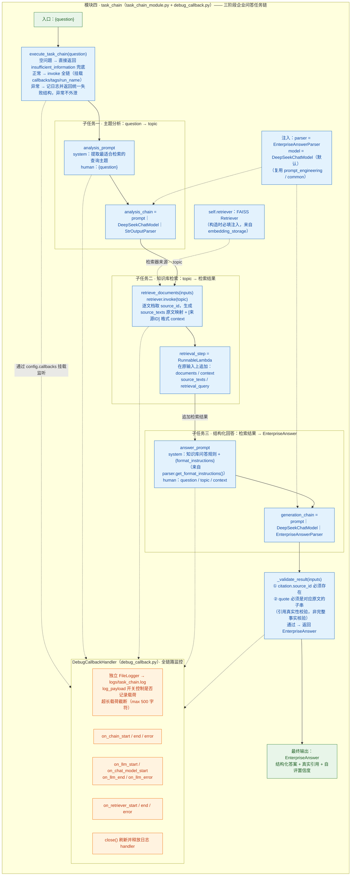

# task_chain 模块结构图

> 任务链模块（`task_chain_module.py` + `debug_callback.py`）：把"主题分析 → 知识检索 → 结构化回答"三个子任务用 LCEL 串成一条链，配全链路监控和异常兜底，是系统的对外主入口。

## 结构与功能解读

- **数据逐阶段累积**：阶段一 `{question, topic}` → 阶段二追加 `documents / context / source_texts` → 阶段三追加 `answer: EnterpriseAnswer`。
- **健壮性设计**：`execute_task_chain` 对空问题、链执行异常都返回统一的 `insufficient_information` 结构，异常不外泄；`DebugCallbackHandler` 覆盖 chain / LLM / retriever 三级回调，把全流程写入 `logs/task_chain.log`。

## 备注

- `debug_callback.py` 顶部 import 块重复了一遍（无害）。
- 任务链组合中 `_validate_result` 只返回 `answer` 对象；检索阶段的 `source_id` 取自 `metadata.source_id`，缺失时回退为 `source_{序号}`。
